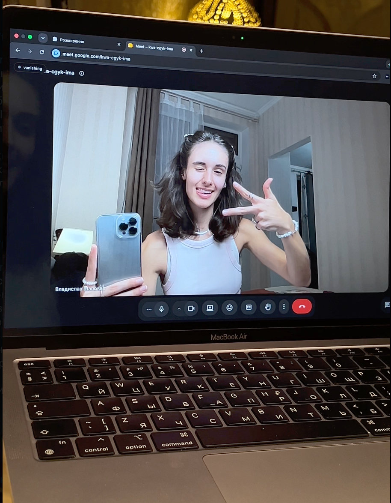
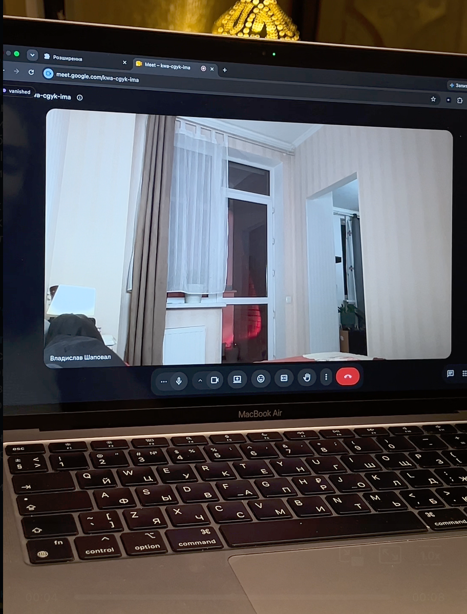
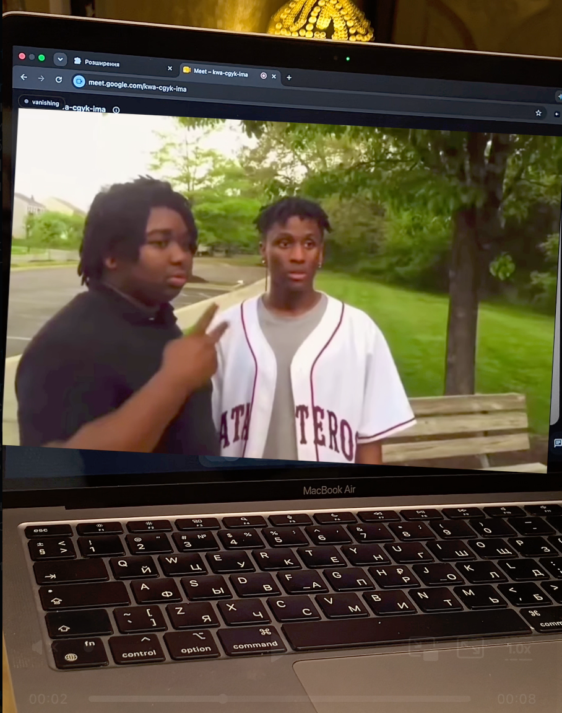

# PeaceOut

Hold up a peace sign (✌️) and fade out of your own video. Show it again to fade back in. Works entirely on your own machine — no server, no account, nothing leaves your device.

Two versions, pick the one that matches how you actually call people:

- **[Chrome extension](#chrome-extension-google-meet)** — Google Meet only, but zero setup beyond loading it
- **[Desktop app](#desktop-app-zoom-discord-teams-anything)** — a virtual camera that works in Zoom, Discord, Teams, or anything else with a camera picker, including the real desktop apps (not just the browser tab) — needs a one-time OBS Studio install


| 1. show the sign | 2. you're gone | 3. that's the bit |
|:---:|:---:|:---:|
|  |  |  |

## Chrome extension (Google Meet)

### What it does

- Hooks your camera feed inside Google Meet only (no other site is touched)
- Lets you photograph an "empty room" once, so when you fade out, the empty room shows through instead of you
- Watches your hand with on-device hand tracking (Google's MediaPipe, bundled locally — nothing is downloaded at runtime)
- Shows a peace sign for about a third of a second → smooth fade out. Show it again → fade back in.
- A keyboard shortcut (`Ctrl/Cmd+Shift+Y`) does the same thing without the gesture

### Install (2 minutes, no building)

1. Click the green **Code** button on this repo → **Download ZIP**, and unzip it somewhere you'll keep it (e.g. your Documents folder)
2. Open Chrome and go to `chrome://extensions`
3. Turn on **Developer mode** (top right)
4. Click **Load unpacked** and select the unzipped `PeaceOut` folder
5. The icon shows up in your toolbar — that's it, no further setup

### Prefer to have an AI do it for you?

If you use [Claude Code](https://claude.com/claude-code) (or a similar coding agent) in your editor, open this folder and say:

> "Load this as an unpacked Chrome extension for me — open chrome://extensions, enable developer mode if it isn't on, and walk me through it."

It can drive the same steps above and tell you exactly where to click.

### Using it

1. Join a Google Meet call
2. Click the small pill in the top-left corner of the page → **capture empty room**
3. Step out of frame for 3 seconds while it photographs the empty room
4. Come back — the pill should say **armed**
5. Hold up a peace sign (✌️) toward the camera for about a third of a second — you fade out
6. Show it again — you fade back in
7. `Ctrl/Cmd+Shift+Y` works as a backup trigger if the gesture ever misfires

**Order matters:** have the extension loaded and the empty room captured *before* you expect to need it mid-call — capturing requires you to step out of frame for a few seconds.

### How it works, briefly

`content.js` intercepts Google Meet's own camera request and swaps in a canvas that either shows the live feed, the saved empty-room photo, or a cross-fade between the two. `gesture.js` runs MediaPipe's hand landmark model against the same camera feed (locally, no network calls) and looks for the index and middle fingers extended with the ring and pinky curled — the peace-sign shape — using distance ratios that hold regardless of hand size or distance from the camera.

One deliberate trade-off, disclosed here on purpose: Google Meet enforces a browser security feature called Trusted Types, and the bundled hand-tracking library isn't written to be compatible with it. To load it at all, the extension installs a permissive Trusted Types policy on the Meet page. That's a known, standard workaround for using a Trusted-Types-incompatible library — but it does mean this specific protection is relaxed on Meet tabs while the extension is active. Nothing is sent anywhere either way; this is strictly about what's allowed to run inside the tab.

## Desktop app (Zoom, Discord, Teams, anything)

A Chrome extension can only ever reach inside a browser tab — it has no way to touch the actual Zoom or Discord desktop apps most people use day to day. This is a separate, small Python program that solves that differently: it reads your real webcam, applies the same fade effect, and republishes the result as a **virtual camera** — a fake webcam that any app, browser or desktop, can pick from its camera list.

### What it does

- Reads your webcam locally with OpenCV and MediaPipe — same peace-sign gate as the extension, same fade effect, just in Python instead of the browser
- Outputs to a virtual camera via [pyvirtualcam](https://github.com/letmaik/pyvirtualcam), backed by OBS Studio's virtual camera driver
- Works in literally anything with a camera dropdown: Zoom app, Discord app, Teams, Slack huddles, FaceTime, you name it
- Nothing leaves your machine — no cloud, no account, same as the extension

### Install

1. Install [Python 3.12](https://www.python.org/downloads/) if you don't have it
2. Install [OBS Studio](https://obsproject.com/download) — **download it from the official site directly, not Homebrew**; the Homebrew cask has a known signature bug that blocks the virtual camera on macOS
3. Open OBS once, click **Start Virtual Camera**, then **Stop Virtual Camera**, then quit OBS. This one-time dance registers the virtual camera device with your system. On macOS you may be asked to approve a system extension (System Settings → General → Login Items & Extensions → Camera Extensions) and restart once — that's normal, only needed the first time.
4. From the `desktop/` folder in this repo:
   ```bash
   cd desktop
   python3.12 -m venv venv
   source venv/bin/activate        # Windows: venv\Scripts\activate
   pip install -r requirements.txt
   ```

### Using it

1. Run it:
   ```bash
   python peaceout.py
   ```
   If the preview window shows the wrong camera (common once OBS's virtual camera exists — it can bump your real webcam to a different index), try `python peaceout.py --camera 1`.
2. Focus the preview window, press **`c`**, step out of frame for 3 seconds — it photographs the empty room
3. Start Zoom/Discord/Teams **after** the script is running, and pick **"OBS Virtual Camera"** as your camera — most apps only scan for cameras once at launch, so starting the script first matters
4. Hold up a peace sign (✌️) — fade out. Show it again — fade back in
5. `v` is a manual backup trigger, `q` quits

### How it works, briefly

Same general pattern as other webcam-filter tools built on OBS's virtual camera (e.g. [itsgiving](https://github.com/gazijarin/itsgiving)): OpenCV owns the real camera, MediaPipe's `Hands` model watches it for the peace sign using the same distance-ratio gate as the Chrome extension, and the rendered frame (live, faded, or the empty room) is pushed out through `pyvirtualcam`, which on macOS and Windows rides on OBS's virtual camera driver. No browser involved at all — this is why it reaches native apps the extension can't.

## Privacy

Everything — camera frames, the empty-room photo, hand tracking — stays on your device. The extension keeps the empty-room photo in `localStorage` on `meet.google.com` only; the desktop app keeps it in memory for the life of the process. Nothing is uploaded anywhere, in either version.

## License

Source-available, not open source — see [LICENSE](LICENSE). Download it and use it for free, personally, however you like. Publishing a copy, a fork, or a modified version elsewhere needs permission first; ask via an issue on this repo.
